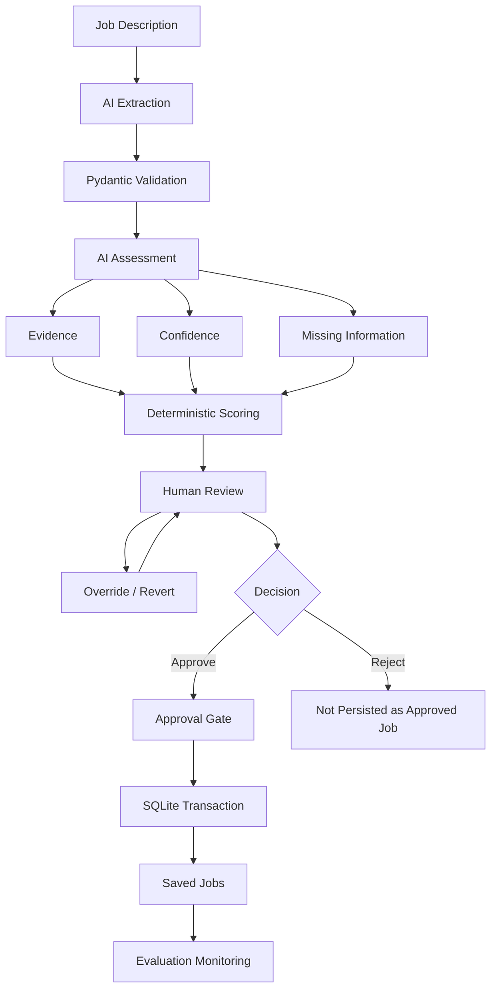

# AI-Assisted Job Application Tracker
**Current release:** `v0.1.0` — Working MVP

**Core design principle:**

> AI proposes. The system validates. The human decides.

### Key Features

- Structured job-description extraction with an LLM
- Evidence-based AI assessment
- Deterministic weighted scoring
- Pydantic validation
- Human override and revert workflow
- Approval-controlled persistence
- Transactional SQLite writes and rollback protection
- Model, prompt and rubric version tracking
- AI-human disagreement monitoring
- Automated test suite

A human-in-the-loop AI decision-support system for evaluating job opportunities against predefined strategic career criteria.

The project combines **LLM-based information extraction and semantic assessment** with **deterministic Python logic, structured validation, human review, transactional persistence, and evaluation monitoring**.

Rather than allowing an AI model to make career decisions autonomously, the system follows a simple principle:

> **AI proposes. The system validates. The human decides.**

## Why I Built This

Evaluating job opportunities involves more than matching keywords between a CV and a job description.

For my own job search, I wanted to evaluate whether a role supports a longer-term career direction from **Data & Analytics toward Data/AI Transformation and eventually broader business transformation responsibilities**.

Doing this manually across many job descriptions creates several problems:

- relevant information must repeatedly be extracted from unstructured job descriptions;
- similar roles can have very different levels of business ownership and transformation exposure;
- subjective judgments can become inconsistent;
- an LLM can produce plausible but unsupported interpretations;
- a single numerical score can hide uncertainty and missing information.

I therefore built this system to explore how AI can automate the language-intensive parts of the process while keeping scoring, workflow control, approval, and consequential decisions outside the model.

## Demo

A recorded end-to-end demonstration of the working MVP is available with the `v0.1.0` release.

▶️ [**Watch the Working MVP Demo**](https://github.com/anhphha/ai-job-application-tracker/releases/download/v0.1.0/working_MVP.mp4)

The demo shows the complete human-in-the-loop workflow:

1. submitting a job description
2. AI-powered structured extraction
3. evidence-based career assessment
4. deterministic scoring
5. confidence and missing-information review
6. human override and score recalculation
7. approval and persistence
8. saved-job review and evaluation monitoring

The demo is intended to show not only the AI output, but also the controls around it: validation, human judgment, traceability, and persistence.

## System Architecture



## What the AI Does

The LLM is used for tasks that require interpretation of natural language.

### 1. Structured Job Extraction

The extraction layer converts an unstructured job description into structured fields such as:

- company;
- role;
- location;
- application deadline;
- responsibilities;
- required skills;
- preferred skills;
- seniority.

The model is instructed not to infer unsupported information. Missing information should remain unknown rather than being invented.

### 2. Evidence-Based Assessment

The system evaluates each role against seven career criteria:

| Criterion | Weight |
|---|---:|
| Transformation | 25% |
| Business Ownership | 20% |
| Stakeholder Exposure | 15% |
| Data Relevance | 15% |
| Decision Influence | 10% |
| Change Adoption | 10% |
| Leadership Potential | 5% |

For every criterion, the AI returns:

- a score from 0–2;
- supporting evidence;
- confidence;
- relevant missing information.

The AI does **not** calculate the final weighted score.

## Deterministic Scoring

Weighted scoring is performed in Python rather than by the language model.

Each criterion score is normalized and multiplied by its predefined weight:

```text
criterion contribution =
(score / 2) × criterion weight
```

The contributions are then combined into a 0–100 **Career Direction Score**.

Keeping this calculation deterministic makes the scoring logic transparent and reproducible.

The score represents alignment with the predefined career direction. It should not be interpreted as a probability of receiving an interview, overall job quality, salary attractiveness, or an objective measure of career success.

## Human-in-the-Loop Design

AI assessment is treated as a proposal rather than a final decision.

A reviewer can:

- inspect the AI score;
- inspect supporting evidence;
- inspect confidence and missing information;
- override a criterion score;
- provide a reason for the override;
- revert an override;
- approve or reject the assessment.

Human overrides do not silently replace the original AI judgment.

The system preserves the distinction between:

```text
Original AI judgment
        |
        v
Human judgment
        |
        v
Effective reviewed score
```

This makes disagreement between the AI and reviewer visible and auditable.

## Reliability and Auditability

A major goal of the project is exploring what makes an AI-enabled workflow reliable beyond simply calling an LLM API.

### Structured Validation

AI responses are validated against Pydantic models before being used by the rest of the application.

### Deterministic Workflow Control

The LLM does not control application state, approval, database transactions, or scoring mathematics.

### Human Approval Gate

Only approved assessments can be persisted as accepted job evaluations.

Pending or rejected reviews are blocked from the approved-job persistence workflow.

### Override History

Human corrections are preserved rather than destructively overwriting previous judgments.

This allows the system to distinguish between the original AI assessment and subsequent human decisions.

### Transactional Persistence

Approved records are written to SQLite using transactions.

If part of the persistence process fails, the transaction is rolled back rather than leaving a partially saved assessment.

### AI Run Metadata

The system can record metadata such as:

- model;
- prompt version;
- rubric version;
- latency;
- status;
- errors.

Historical assessments for which metadata was never recorded remain explicitly marked as unknown rather than having metadata reconstructed or fabricated.

### AI-Human Disagreement

The evaluation layer tracks human override events and active AI-human disagreements.

Human disagreement is **not treated as model accuracy or ground truth**. Instead, it is used as a signal for identifying rubric definitions and model judgments that deserve further evaluation.

## What I Learned

Building the system exposed several important challenges in practical LLM evaluation.

For example, an AI model may interpret:

- technical autonomy as leadership;
- analysis used in decision-making as decision authority;
- deployment as change adoption;
- technical ownership as business outcome ownership;
- cross-functional collaboration as senior stakeholder exposure.

These cases showed why prompt design alone is insufficient.

A reliable AI workflow also requires explicit definitions, deterministic controls, human review, traceability, and systematic evaluation of disagreement.

Instead of continuously changing the rubric until individual scores look desirable, the current version keeps the rubric stable while additional real-world cases are evaluated.

## Technology Stack

- **Python**
- **OpenAI API / LLM structured outputs**
- **Pydantic**
- **Streamlit**
- **SQLite**
- **pytest**
- **python-dotenv**
- **Git**

## Project Structure

```text
ai-job-tracker/
|
|-- app.py
|-- extractor.py
|-- assessor.py
|-- models.py
|-- criteria.py
|-- scoring.py
|-- workflow.py
|-- database.py
|
|-- prompts/
|   |-- extraction.txt
|   `-- assessment.txt
|
|-- tests/
|   |-- test_extraction.py
|   |-- test_assessor.py
|   |-- test_pipeline.py
|   |-- test_workflow.py
|   `-- test_database.py
|
|-- .env.example
|-- .gitignore
|-- requirements.txt
`-- README.md
```

Local databases, API credentials, Python cache files, and personal job-search data are excluded from version control.

## Running the Project Locally

### 1. Clone the repository

```bash
git clone <repository-url>
cd ai-job-tracker
```

### 2. Create a virtual environment

```bash
python -m venv .venv
source .venv/bin/activate
```

On Windows:

```bash
.venv\Scripts\activate
```

### 3. Install dependencies

```bash
pip install -r requirements.txt
```

### 4. Configure the API key

Copy the example environment file:

```bash
cp .env.example .env
```

Then add your own API key:

```text
OPENAI_API_KEY=your_api_key_here
```

The real `.env` file is excluded from version control.

### 5. Start the application

```bash
streamlit run app.py
```

## Testing

Run the test suite with:

```bash
pytest -v
```

The current MVP includes tests covering the major extraction, assessment, workflow, persistence, and pipeline components.

Before the `v0.1.0` release, the complete test suite was run successfully.

## Current Limitations

This project is currently a working MVP demonstrating production-minded AI design rather than a production deployment.

Known limitations include:

- the evaluation rubric is still being calibrated;
- the evaluation dataset is currently limited;
- LLM outputs can vary between runs;
- human review remains necessary for ambiguous judgments;
- automated API retry and recovery mechanisms are not yet complete;
- authentication and multi-user authorization are not implemented;
- SQLite is used for local persistence;
- human overrides represent reviewer judgment, not objective ground truth.

These limitations are intentionally documented rather than hidden because they define the next reliability and evaluation problems to solve.

## Roadmap

Planned development includes:

1. build a fixed regression suite from representative job descriptions;
2. evaluate rubric and prompt changes against the same cases;
3. strengthen error handling, retries, and observability;
4. analyze AI-human disagreement patterns by criterion;
5. improve reproducibility across model and prompt versions;
6. expand reliability testing for failed API and database operations.

The goal is not to make the AI autonomous.

The goal is to make AI assistance **useful, controlled, explainable, and reliable enough to support a real decision-making workflow**.

## Version

**v0.1.0 — Working MVP**

The first release establishes the end-to-end workflow from job-description extraction through AI assessment, deterministic scoring, human review, approved persistence, and evaluation monitoring.